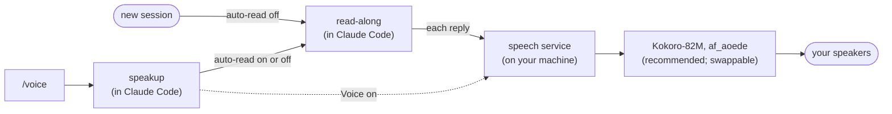

# Speakup for Claude Code


[](https://huggingface.co/hexgrad/Kokoro-82M)

[](https://github.com/tomfluff/claude-read-along)
[](LICENSE)

A mod for Claude Code: Claude reads its replies to you out loud, but only
when you ask. Every session starts silent. Type **`/voice`** and it starts
talking; type it again and it stops. The recommended voice model is
[Kokoro-82M](https://huggingface.co/hexgrad/Kokoro-82M), with its natural
**af_aoede** voice, and it's what speakup sets up by default. Prefer another
voice? [Swap it out](#swapping-the-voice).

Speakup is for anyone who wants Claude's voice some of the time, not all of
it: on for a long explanation you'd rather listen to while you look at the
code, off again in a meeting, a shared office, or a quick back-and-forth.
It's a thin layer on top of [read-along](https://github.com/tomfluff/claude-read-along),
which does the speaking and highlights the sentence you're hearing.

- **Silent by default.** New sessions never start reading on their own.
- **One command.** `/voice` toggles it, and says "Voice on" so you know it worked.
- **Recommended: Kokoro-82M.** A voice that sounds like a person
  (af_aoede at 0.9×), set up for you on the first session.
- **Swappable.** Any of Kokoro's ~50 voices, your system's voices, or a
  voice of your own ([below](#swapping-the-voice)).
- **Local and private.** The voice runs on your machine. Nothing you hear
  is sent anywhere.
- **`/v` for everything else.** A shorthand for read-along's controls:
  `/v pause`, `/v stop`, `/v speed 1.2`.

## Recommended voice model: Kokoro-82M

[Kokoro-82M](https://huggingface.co/hexgrad/Kokoro-82M), by hexgrad, is the
voice model we recommend, and the one speakup sets up by default: an open-weight, 82-million-parameter text-to-speech model
(Apache 2.0) that sounds close to a person reading, yet is small enough to
run on a laptop's CPU at about three times real time. No cloud service, no
API key, no GPU.

Speakup picks its **af_aoede** voice (American English; the `af` is
American, female) at 0.9× speed. read-along's setup installs
[kokoro-onnx](https://github.com/thewh1teagle/kokoro-onnx) to run it, about
1 GB with the model. Kokoro also speaks British English, Spanish, French,
Hindi, Italian, Portuguese, Chinese and Japanese
([its voices](https://huggingface.co/hexgrad/Kokoro-82M/blob/main/VOICES.md)),
and read-along switches voice by itself for a sentence in another script.

It's a recommendation, not a requirement. Speakup works with any voice
read-along can use: another Kokoro voice, your system's built-in voices, or
Pocket TTS and a voice of your own. If Kokoro-82M isn't installed, read-along
falls back to the best voice the machine has. See
[Swapping the voice](#swapping-the-voice).

## What you need

- **Claude Code 2.1.299 or later, in the terminal.** Speakup is a mod, a
  plugin that changes how Claude Code behaves.
- **[read-along](https://github.com/tomfluff/claude-read-along)**, which
  speakup drives. The install below covers it.
- **WSL, Linux or macOS**, as read-along needs.
- **Python 3.10 to 3.13** for Kokoro-82M's packages (only with Kokoro), or
  [uv](https://docs.astral.sh/uv/), which fetches a Python of its own.
- **An audio player:** `ffplay` (comes with ffmpeg) or SoX's `play`.
- **About 1 GB of disk** for Kokoro-82M and its runtime (recommended; skip
  it to use your system's voices instead).

## Install

The easiest way is to let Claude do it. Paste this at the Claude Code prompt:

```
Install the speakup mod by following https://github.com/tim-rayner/mods/blob/main/speakup/README.md (the "Agent setup" section).
```

Claude asks before it installs anything. Or do it yourself, at the prompt:

```
/plugin install read-along --marketplace tomfluff/claude-read-along
/read-along setup
/plugin install speakup --marketplace tim-rayner/mods
```

Answer `y` to add each marketplace, then pick the user scope. `/read-along setup`
walks you through installing Kokoro-82M, the recommended voice model (you can
decline it and use your system's voices). Then open a new session and type `/voice`.

### Agent setup

Steps for an agent installing speakup for someone. Run them in order; each is
safe to re-run. Ask the person before steps that install software (2 and 3),
saying what and how big.

1. **Check the machine.** macOS, Linux or WSL, with `python3` and `claude` on
   the PATH. Kokoro's packages need Python 3.10 to 3.13, or `uv`.

2. **Install read-along**, which runs the voice:

   ```bash
   claude plugin marketplace add tomfluff/claude-read-along
   claude plugin install read-along@claude-read-along
   ```

3. **Install Kokoro-82M, the recommended voice model (about 1 GB), and check
   for an audio player.** Recommend it to the person; if they'd rather not
   download it, skip the `setup.py` line and read-along uses the machine's
   own voices. read-along's setup downloads the model, checks it against its
   SHA-256, and installs its runtime in a folder of its own:

   ```bash
   RA="$(ls -d ~/.claude/plugins/cache/claude-read-along/read-along/*/ | sort -V | tail -1 | sed 's#/$##')"
   python3 -I "$RA/bin/setup.py" kokoro       # a few minutes: run it in the background and wait
   python3 -I "$RA/bin/speakd.py" --doctor    # "[x] Kokoro" and a Player line mean it's ready
   ```

   If the doctor says there's no player: on macOS `brew install ffmpeg`; on
   Debian, Ubuntu or WSL `sudo apt install ffmpeg` (ask before using sudo).
   If `setup.py` says the Python is too new or old, install `uv`
   (`brew install uv`, or `curl -LsSf https://astral.sh/uv/install.sh | sh`)
   and run it again. read-along's `/read-along setup` skill covers anything else.

4. **Install speakup:**

   ```bash
   claude plugin marketplace add tim-rayner/mods
   claude plugin install speakup@tim-mods
   ```

5. **Hand over.** Tell the person to open a new Claude Code session (or run
   `/reload-plugins` in this one) and type `/voice`. They should hear
   "Voice on" in the aoede voice (or a system voice, without Kokoro), then
   each reply read aloud.

There's nothing to configure by hand: speakup sets read-along up itself
([Settings](#settings)).

## Using it

Type **`/voice`** to turn reading on for this session; Claude says "Voice on",
and from then on each reply is read aloud when it's done. Type it again to
stop. Next session, it's off again.

| Command | |
|---|---|
| `/voice` | toggle reading replies aloud for this session |
| `/voice on`, `/voice off` | set it either way (`off` also stops anything being read) |
| `/voice all` | read every update Claude writes between tool calls too, not just the final reply |
| `/voice dictation …` | pass through to Claude Code's built-in `/voice` (dictation), where your build has one |
| `/v …` | shorthand for `/read-along …` |
| `/v pause`, `/v stop` | pause and resume, or stop |
| `/v read` | read the last reply |
| `/v speed 1.2` | set the speed (0.5 to 4) |
| `/v voice kokoro:af_heart` | change the voice for this session |
| `/v save` | keep this session's voice and speed as the defaults |
| `/v` | open read-along's settings |

read-along's buttons work as usual: hover a message to play it, and use the
player above the prompt to pause, skip or change speed.

## Swapping the voice

Kokoro-82M with af_aoede is the recommended default, not a requirement.
Speakup sets the voice once, on its first session, so whatever you choose
afterwards stays, and `/voice` works the same with all of them.

| Voice | Example | Setup |
|---|---|---|
| **Another Kokoro voice** | `kokoro:af_heart`, `kokoro:bf_emma`, `kokoro:am_michael` | none: about 50 come with Kokoro-82M (`--japanese` at setup adds Japanese) |
| **macOS voices** | `mac:Samantha`, `mac:Ava (Premium)` | built in; Enhanced and Premium voices are free in System Settings → Accessibility → Spoken Content |
| **Windows voices** | `win:Microsoft Aria` | built in, on WSL |
| **eSpeak NG** | `espeak:en-us` | `sudo apt install espeak-ng`; robotic, but about 100 languages |
| **Pocket TTS** | `pocket:alba`, or `pocket:me` for your own voice | `python3 -I "$RA/bin/setup.py" pocket` (about 1.3 GB) |

Try one with `/v voice <voice>`, list what's installed with `/v voices`, and
keep it with `/v save`. The system voices need no download, so skip
Kokoro-82M at install if 1 GB is too much. Pocket TTS can clone a voice from
a short recording: see
[read-along's Pocket TTS notes](https://github.com/tomfluff/claude-read-along#pocket-tts),
and only clone your own voice or one whose owner agreed.

To change the default for everyone you share speakup with, fork this
repository and change `VOICE` and `SPEED` at the top of
[`hooks/register.tsx`](hooks/register.tsx).

## Settings

Speakup has no settings of its own. It sets three of read-along's, in
`/config` under read-along:

| Setting | Speakup sets | When |
|---|---|---|
| Auto-read Claude's replies | `off` | at the start of every session, so only `/voice` turns it on |
| Voices | `main=kokoro:af_aoede, auto` | once, on its first session |
| Speed | 0.9 | once, on its first session |

`/voice` changes auto-read for the current session only, the way
`/read-along auto replies final` would. Everything else is read-along's:
see [its settings](https://github.com/tomfluff/claude-read-along#settings).

## Privacy

Speakup sends nothing over the network. It talks only to read-along's speech
service, over a Unix socket on your machine, and to Claude Code's own
settings. Kokoro-82M runs locally; the network is used once, by read-along's
setup, to fetch the model and its Python packages. See
[read-along's privacy notes](https://github.com/tomfluff/claude-read-along#privacy).

## Troubleshooting

- **`/voice` didn't answer "Voice on" or "Voice off"?** The session started
  before speakup was installed or updated: run `/reload-plugins`.
- **Replies are read without `/voice`?** Speakup isn't loaded. Check
  `claude plugin list` shows `speakup@tim-mods` enabled, then open a new session.
- **"Voice on" was said in a different voice?** read-along's speech service
  wasn't reachable, so speakup used the system voice for that one line. The
  replies still use your chosen voice; if they don't, run `/read-along restart`.
- **Silent?** Run `/read-along doctor`, then look at the service's log:
  `/tmp/read-along-<your uid>.log`.
- **Wanted dictation?** Speakup answers `/voice`; use `/voice dictation` for
  Claude Code's own.
- **The first read is slow.** Kokoro loads its model on the first read of a
  session (a few seconds), then keeps it while it's in use.

## How it works



[`hooks/register.tsx`](hooks/register.tsx) is all of speakup. At session
start it registers `/voice` and `/v` and turns read-along's auto-read off.
`/voice` runs `/read-along auto replies final` (or `off`, then `stop`), and
on the way on sends "Voice on" to read-along's speech service in the same
voice. `/v` hands its arguments to `/read-along`.

## Credits and licence

**Speakup is built on [read-along](https://github.com/tomfluff/claude-read-along)
by [Yotam](https://github.com/tomfluff).** read-along does all of the
speaking: the speech service, the Kokoro setup, the voices, the highlight and
the player. Speakup only decides when it speaks, and wouldn't exist without it.
Speakup also follows read-along's own conventions to talk to its speech
service (the socket, the `/speak` request, and how the Voices setting is
read), and this README follows the structure of read-along's. read-along is
MIT licensed, © Yotam; speakup bundles none of its code, and you
install it from [its own repository](https://github.com/tomfluff/claude-read-along).

The recommended voice model is [Kokoro-82M](https://huggingface.co/hexgrad/Kokoro-82M) by
hexgrad (Apache-2.0), run by
[kokoro-onnx](https://github.com/thewh1teagle/kokoro-onnx) (MIT), both
installed by read-along's setup.

Speakup itself is MIT licensed; see [LICENSE](LICENSE).
